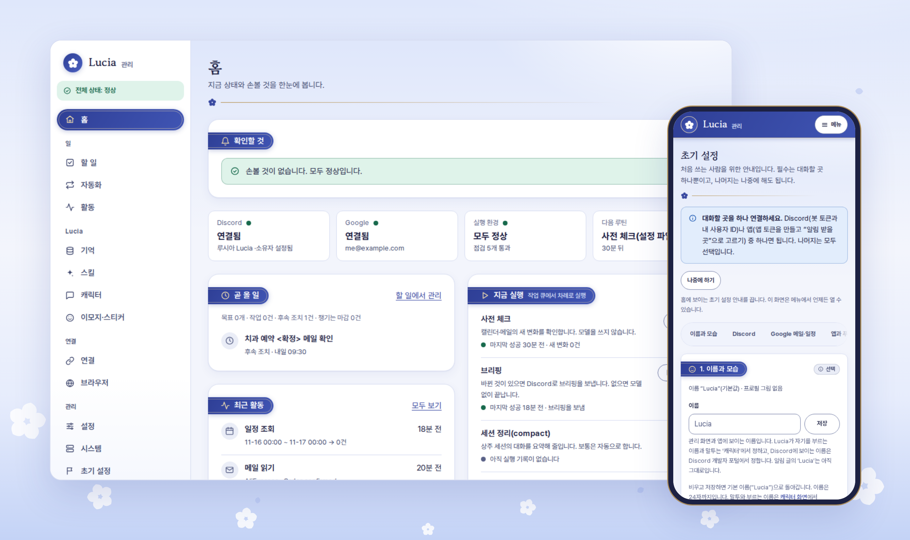

<p align="center">
  <picture>
    <source media="(prefers-color-scheme: dark)" srcset="docs/assets/readme/banner-dark.png">
    
  </picture>
</p>

<p align="center">
  <a href="#빠르게-올리기"><b>빠르게 올리기</b></a> ·
  <a href="docs/DEPLOY.md">배포 가이드</a> ·
  <a href="docs/STATUS.md">기능과 권한</a> ·
  <a href="#앱-lucent">안드로이드 앱</a> ·
  <a href="docs/app-api.md">앱 접속 API</a>
</p>

**Lucia**는 홈서버에서 늘 켜 두는 **한 사람용 개인 비서 에이전트**다. Claude Code를 실행 엔진으로 쓰고, 그 바깥의 일(기억, 일정, 상태, 알림, 승인)은 Rust 데몬 `luciad`가 맡는다.

<table>
  <tr><td width="170"><b>기억하고 이어 간다</b></td><td>메신저(Discord DM이나 <a href="#앱-lucent">안드로이드 앱</a>)로 말을 걸면 답하고, 맡긴 일을 기억했다가 스스로 챙긴다.</td></tr>
  <tr><td width="170"><b>사람 없이도 돈다</b></td><td>아침 브리핑, 메일·일정 변화 알림, 약속한 후속 조치, 반복 루틴, 페이지 감시.</td></tr>
  <tr><td width="170"><b>묻고 나서 한다</b></td><td>메일을 보내거나 폼을 제출하는 것처럼 바깥에 남는 일은 <b>승인 카드</b>로 먼저 묻는다.</td></tr>
  <tr><td width="170"><b>가둬 놓고 쓴다</b></td><td>에이전트는 가상 머신(Docker Sandboxes) 안에서만 돌고, 계정과 자료에 닿는 일은 호스트의 데몬이 확인하고 대신 한다.</td></tr>
</table>

<p align="center">
  <picture>
    <source media="(prefers-color-scheme: dark)" srcset="docs/assets/readme/showcase-dark.png">
    
  </picture>
</p>

<p align="center"><sub>관리 화면. 상태를 보고, 승인하고, 연결과 캐릭터를 정한다. 그림은 시험 데이터로 찍은 것이다.</sub></p>

<p align="center">
  <picture>
    <source media="(prefers-color-scheme: dark)" srcset="docs/assets/readme/divider-dark.svg">
    
  </picture>
</p>

## 빠르게 올리기

x86-64 리눅스 서버에서 한 줄이면 된다.

```sh
curl -fsSL https://github.com/mooner1022/lucia/releases/latest/download/install.sh | bash
```

빌드해 둔 릴리스를 받아 체크섬을 맞춰 보고 `~/.local/lib/lucia/release`에 푼 뒤, 처음이면 `deploy/setup.sh`가 묻고 답하며 끝까지 데려간다: 준비물 확인 → sbx·Claude 로그인 → 설정 파일 → Lucia가 사는 샌드박스 → 설치 → 관리 페이지 비밀번호 링크. Rust와 Node.js는 필요 없다. 이미 된 단계는 건너뛰므로 중간에 멈췄다가 다시 돌려도 된다. 이미 설치돼 있으면 같은 명령이 업데이트다(저장소를 백업하고 바이너리를 바꿔 재시작한다). 지금 상태만 보려면 `~/.local/lib/lucia/release/deploy/setup.sh --check`.

준비물: KVM이 되는 리눅스 서버(systemd 256 이상. Ubuntu 26.04에서 확인했고 24.04에서는 되지 않는다), Docker 계정, Claude 구독. [Docker Sandboxes(`sbx`)](https://docs.docker.com/ai/sandboxes/)는 Ubuntu면 `setup.sh`가 명령을 보여 주고 허락을 받은 뒤 설치해 준다. 다른 배포판에서는 명령만 알려 준다.

레포에서 빌드하려면(개발하거나 x86-64가 아닐 때) Rust 1.93 이상과 Node.js(빌드에만)가 더 필요하다.

```sh
git clone https://github.com/mooner1022/lucia.git ~/lucia && cd ~/lucia
deploy/setup.sh
```

걷어 낼 때는 `deploy/uninstall.sh`(받아서 설치했다면 `~/.local/lib/lucia/release/deploy/uninstall.sh`)가 반대 순서로 묻고 지운다(`--check`는 남은 것만 보여 준다).

레포에서 빌드한 경우, 손으로 하려면 같은 순서를 명령으로 따라간다.

```sh
sbx login && sbx policy init deny-all        # 그리고 임시 샌드박스에서 Claude /login (docs/DEPLOY.md 2장)
mkdir -p ~/.config/lucia && cp deploy/lucia.example.toml ~/.config/lucia/lucia.toml
deploy/create-sandbox.sh                     # Lucia가 사는 샌드박스
deploy/install.sh                            # 빌드, 설치, 서비스 시작
~/.local/lib/lucia/luciad check              # 모두 ✓인지
~/.local/lib/lucia/luciad admin-setup        # 관리 페이지 비밀번호 링크(터미널에 찍힌다)
```

링크에서 비밀번호를 정하고 로그인하면 **초기 설정** 화면이 뜬다. 여기서 이름과 프로필 그림, Discord 봇, Google 메일·일정, 앱 푸시(Firebase), 이미지 생성 키를 넣는다. 필수는 대화할 곳 하나(Discord 봇이나 앱)뿐이다.

단계마다의 설명, 선택 기능(브라우저, 코드 실행, 앱 접속 API, 밖에서 접속), 업데이트와 되돌리기, 막혔을 때 볼 것은 [배포 가이드](docs/DEPLOY.md)에 있다.

<p align="center">
  <picture>
    <source media="(prefers-color-scheme: dark)" srcset="docs/assets/readme/divider-dark.svg">
    
  </picture>
</p>

## 앱: Lucent

<a href="https://github.com/mooner1022/lucent"></a>

<b><a href="https://github.com/mooner1022/lucent">Lucent</a></b>는 Lucia의 안드로이드 클라이언트다. Discord 없이도 같은 Lucia와 같은 기억으로 이야기한다.

- 대화, 진행 안내, 파일, 승인 카드(버튼과 값 입력)를 받는다. 앱이 꺼져 있으면 푸시(FCM)가 깨운다.
- Lucia가 사이트에 로그인해야 할 때 아이디와 비밀번호를 앱의 카드에서 넣고, 사람 확인(캡차) 화면은 넘겨받아 직접 푼다.
- 사용자가 켠 휴대폰 기능(위치, 알림 읽기 등)만 Lucia에게 내준다.

데몬 쪽에서는 설정 `[gateway]`를 켜고 관리 화면의 초기 설정 → "앱과 푸시"에서 토큰을 발급한다([배포 가이드 7장](docs/DEPLOY.md)). 앱이 따르는 규격은 [`docs/app-api.md`](docs/app-api.md)다.

<p align="center">
  <picture>
    <source media="(prefers-color-scheme: dark)" srcset="docs/assets/readme/divider-dark.svg">
    
  </picture>
</p>


## 구성

| 부분 | 무엇 |
|---|---|
| `crates/luciad` | 데몬: 채널, 스케줄러, 작업 큐, 저장소(SQLite), MCP 서버, 승인 데스크, 브라우저 프록시, 관리 페이지, 앱 접속 API |
| `crates/lucia-*` | 공통 타입, 채널 어댑터(Discord), 실행 계층(Claude Code), 저장소, 사전 체크 |
| `web/admin` | 관리 화면(Svelte, 빌드해서 데몬 바이너리에 넣는다) |
| `plugin/` | 샌드박스에 읽기 전용으로 붙는 훅(허용 도구 이중 방어) |
| `character/character.md` | 캐릭터(이름, 말투, 관계). 관리 페이지 "캐릭터"에서 고친다 |
| `deploy/` | 설치 스크립트, 샌드박스 만들기, 서비스 유닛, 설정 예시 |

샌드박스는 셋까지 쓴다: 상주 대화(`lucia`), 로그인 프로필을 가진 브라우저(`lucia-browser`, 선택), Lucia가 쓴 코드를 돌리는 곳(`lucia-script`, 선택).

## 문서

- [배포 가이드](docs/DEPLOY.md): 처음 올리기부터 업데이트까지
- [구현 현황](docs/STATUS.md): 무엇을 할 수 있고 누가 어디까지 할 수 있는지(기능과 권한)
- [앱 접속 API](docs/app-api.md): 앱이 붙는 WebSocket·HTTP 규격. 안드로이드 클라이언트는 [Lucent](https://github.com/mooner1022/lucent)
- [결정 기록](docs/decisions/): 설계를 그렇게 한 까닭
- [개발 계획](docs/PLAN.md), [PoC 결과](poc/RESULTS.md)

## 개발

```sh
cargo test --workspace                     # 모델을 부르지 않는다
deploy/build-ui.sh                         # 관리 화면: 의존성, 타입 검사, 시험, 빌드
web/admin/e2e/run.sh --sets stress,full,alt --shots   # 실제 브라우저로 배치 검사
```

개발할 때의 규칙(보호 영역, 인증 정보 다루기, 관리 화면 짜는 법)은 [`CLAUDE.md`](CLAUDE.md)에 있다. 문서와 주석은 한국어로 쓴다.

## 알아 둘 것

- 소유자 한 명을 위한 구성이다. 여러 사용자를 나누는 기능은 없다.
- 대화와 정기 실행이 Claude 구독 사용량을 쓴다.
- 관리 페이지와 접속 API는 집 LAN·VPN 주소에만 연다. 밖으로 열 때는 TLS를 맡는 리버스 프록시와 2단계 인증을 쓴다.

<p align="center">
  <picture>
    <source media="(prefers-color-scheme: dark)" srcset="docs/assets/readme/divider-dark.svg">
    
  </picture>
</p>

<p align="center">
  <br>
  <sub>구름처럼, 조용히 흐르고 달빛처럼, 은은히 비추며…</sub>
</p>
